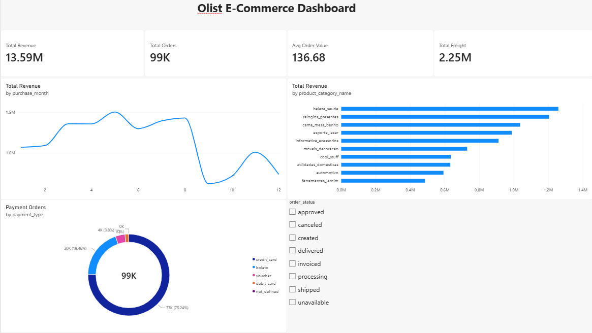
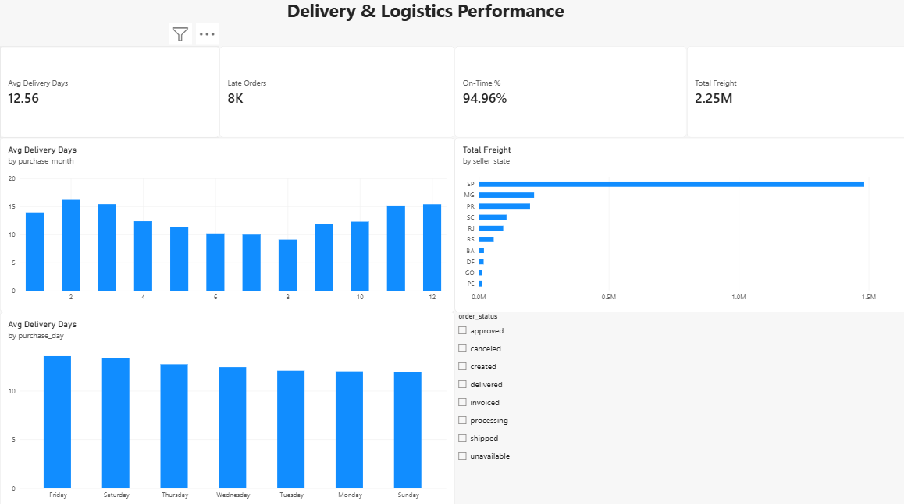

# Olist E-Commerce Dashboard (Power BI)

An interactive two-page Power BI dashboard analysing the Brazilian Olist e-commerce dataset. **Page 1** covers sales performance (revenue, orders, categories, payments). **Page 2** covers delivery and logistics performance (delivery time, late orders, freight cost).

### Page 1: Sales Overview


### Page 2: Delivery & Logistics Performance


## Project Overview

| Item | Details |
|---|---|
| Tool | Microsoft Power BI Desktop |
| Dataset | Olist Brazilian E-Commerce (orders, items, payments, products, sellers, geolocation) |
| Type | Group project |

## Objectives

- Build a clean data model linking the Olist tables.
- Create DAX measures for sales and delivery metrics.
- Present revenue, order, category and payment trends in one interactive page.
- Analyse delivery time, late orders and freight cost on a second page.
- Let users filter both pages by order status.

## Data Model

All relationships are **Many-to-One, single direction**:

| From (many) | To (one) | Key |
|---|---|---|
| olist_order_items_dataset | olist_orders_cleaned | order_id |
| olist_order_payments_dataset | olist_orders_cleaned | order_id |
| olist_order_items_dataset | olist_products_dataset_cleaned | product_id |
| olist_order_items_dataset | olist_sellers_dataset | seller_id |

`olist_geolocation_dataset` is kept unconnected, because zip-code prefixes repeat and would create many-to-many relationships.

## DAX Measures

```DAX
Total Revenue = SUM(olist_order_items_dataset[price])
Total Orders = DISTINCTCOUNT(olist_orders_cleaned[order_id])
Avg Order Value = DIVIDE([Total Revenue], [Total Orders])
Total Freight = SUM(olist_order_items_dataset[freight_value])
Payment Orders = DISTINCTCOUNT(olist_order_payments_dataset[order_id])

Avg Delivery Days = AVERAGE(olist_orders_cleaned[delivery_days])

Late Orders =
COUNTROWS(FILTER(olist_orders_cleaned,
    olist_orders_cleaned[order_delivered_customer_date] > olist_orders_cleaned[order_estimated_delivery_date]))

On-Time % =
DIVIDE(
    COUNTROWS(FILTER(olist_orders_cleaned,
        olist_orders_cleaned[order_delivered_customer_date] <= olist_orders_cleaned[order_estimated_delivery_date])),
    COUNTROWS(FILTER(olist_orders_cleaned,
        NOT ISBLANK(olist_orders_cleaned[order_delivered_customer_date]))))
```

`Payment Orders` is used for the donut chart because the payments table is on the "many" side of its relationship, so `Total Orders` would not split by payment type.

## Dashboard Components

### Page 1: Sales Overview

| Visual | Fields | Purpose |
|---|---|---|
| Cards | Total Revenue, Total Orders, Avg Order Value, Total Freight | Headline KPIs |
| Line chart | purchase_month, Total Revenue | Revenue trend by month |
| Bar chart | product_category_name, Total Revenue (Top 10) | Best-performing categories |
| Donut chart | payment_type, Payment Orders | Payment method share |
| Slicer | order_status | Filter the page |

### Page 2: Delivery & Logistics Performance

| Visual | Fields | Purpose |
|---|---|---|
| Cards | Avg Delivery Days, On-Time %, Late Orders, Total Freight | Delivery KPIs |
| Column chart | purchase_month, Avg Delivery Days | Seasonality of delivery time |
| Column chart | purchase_day, Avg Delivery Days | Delivery time by weekday |
| Bar chart | seller_state, Total Freight (Top 10) | Freight cost by seller state |
| Slicer | order_status | Filter the page |

## Key Insights

### Sales
1. The business generated about **13.59M** in revenue from about **99K orders**, with an average order value of about **136.68**.
2. Top categories are `beleza_saude`, `relogios_presentes`, `cama_mesa_banho`, `esporte_lazer` and `informatica_acessorios`. Revenue is spread across many categories.
3. Credit card is the main payment method (about **75%** of orders), followed by boleto (about **19%**).
4. Monthly revenue peaks around months 5 to 8 and then drops in months 9 and 10. Months are summed across years and the dataset does not cover every month of every year, so part of the late-year dip reflects missing data.

### Delivery and Logistics
1. Orders take about **12.6 days** on average to be delivered.
2. About **95%** of delivered orders arrive on or before the estimated date. Roughly **8K** orders were late.
3. Delivery time changes by month, with longer averages at the start and end of the year and shorter ones around mid-year. Weekday has little effect.
4. Freight cost is concentrated in **SP (São Paulo)**, far ahead of MG, PR, SC, RJ and RS.
5. Total freight is about **2.25M**, roughly 17% of revenue.

## Recommendations

- Focus marketing and stock on the top categories.
- Offer instalment or credit card promotions, since most customers pay by card.
- Plan extra logistics capacity for the slower months at the start and end of the year.
- Review freight cost per order, especially for sellers in high-cost states.
- Use a complete multi-year date range before drawing seasonality conclusions.

## How to Use

1. Install [Power BI Desktop](https://powerbi.microsoft.com/desktop/) (free, Windows only).
2. Download [olist_Dashboard.pbix](https://drive.google.com/file/d/1RxJVylaNvjfBnKGLFZPRPKdPq-Qjc8as/view?usp=drive_link) from Google Drive. The file is too large to store on GitHub.
3. Open it in Power BI Desktop. If it asks for the data, point it to the Olist CSV files.
4. Use the **order_status** slicer on each page to explore the data.

## Repository Structure

```
powerbi/
├── README.md
├── dashboard-page1.png
└── dashboard-page2.png
```

## Dataset Source

[Brazilian E-Commerce Public Dataset by Olist](https://www.kaggle.com/datasets/olistbr/brazilian-ecommerce) on Kaggle. Please download the CSV files from there.
